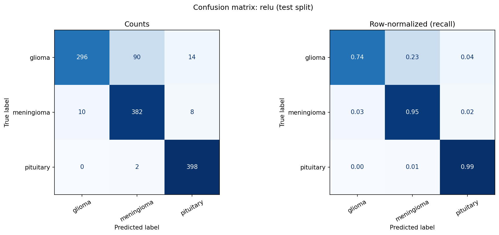
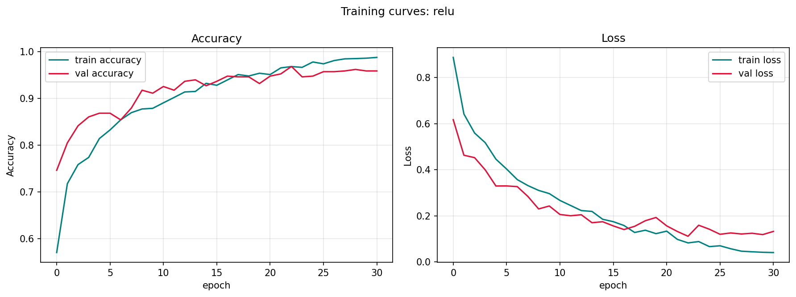

# Brain Tumor MRI Classification

A convolutional neural network that classifies brain MRI scans into three tumor
types (glioma, meningioma, pituitary). It reaches **89.7% accuracy on a held-out
test split** of 1,200 scans that were never used for training or model selection.

> This is not a diagnostic tool. It is a machine learning exercise on a public
> dataset. See [Limitations](#limitations).

---

## Results

All three variants were trained on the same split, with the learning rate held
fixed so the comparison isolates one change at a time.

| Architecture | Activation | BatchNorm | Val acc | **Test acc** | Macro F1 | Epochs |
|---|---|---|---|---|---|---|
| **`relu`** | ReLU | no | 0.9683 | **0.8967** | **0.8945** | 31 (best at 23) |
| `elu_bn` | ELU | yes | **0.9698** | 0.8958 | 0.8942 | 36 (best at 28) |
| `relu_bn` | ReLU | yes | 0.9444 | 0.8667 | 0.8636 | 19 (best at 11) |

**Validation accuracy overstates test accuracy by about seven points**, and it
does so for every architecture (0.9683 vs 0.8967, 0.9698 vs 0.8958, 0.9444 vs
0.8667). Validation is drawn from the same `Training/` pool the model fits on,
while `Testing/` is a separate directory. That gap is the reason validation is
used only for early stopping here, and never reported as a result.

Note that `relu` and `elu_bn` are effectively tied on test accuracy: 0.8967
against 0.8958 is a difference of one image out of 1,200. Do not read that as a
ranking. Repeat runs of `relu` alone land between 0.8967 and 0.9017 (see
[Limitations](#limitations)), which is a wider spread than the gap between the
two architectures.

**Batch normalization hurt this architecture**, and that difference is large
enough to trust. Comparing `relu` against `relu_bn` isolates it: adding BatchNorm
cost 3.0 points of test accuracy and triggered early stopping at epoch 19. When
BatchNorm is present, switching ReLU for ELU recovers about 2.9 points, so the
two changes largely cancel out. Holding the learning rate fixed across all three
runs is what makes those two statements separable.

### Per-class performance, `relu` (best model)

| Class | Precision | Recall | F1 | Support |
|---|---|---|---|---|
| glioma | 0.9673 | **0.7400** | 0.8385 | 400 |
| meningioma | 0.8059 | 0.9550 | 0.8741 | 400 |
| pituitary | 0.9476 | 0.9950 | 0.9707 | 400 |



Glioma is the weak class, and the errors run in one direction. Of 400 gliomas,
296 are classified correctly and **90 are misread as meningioma**. That single
cell accounts for 73% of the 124 test errors. Meanwhile only 10 meningiomas are
mistaken for glioma, so the confusion is not symmetric.

| true (rows) / predicted (columns) | glioma | meningioma | pituitary |
|---|---|---|---|
| **glioma** | 296 | **90** | 14 |
| **meningioma** | 10 | 382 | 8 |
| **pituitary** | 0 | 2 | 398 |

Pituitary tumors are close to solved at 99.5% recall, which makes sense since
they are anatomically distinct and appear in a consistent location. Glioma
versus meningioma is the pair worth working on, and an aggregate accuracy figure
would not have shown that.



---

## Dataset

[Brain Tumor MRI Dataset](https://www.kaggle.com/datasets/masoudnickparvar/brain-tumor-mri-dataset)
by Masoud Nickparvar, downloaded through `kagglehub` on first run. No credentials
are needed and no image data is committed to this repo.

The source dataset ships four classes. `notumor` is dropped, since this project
targets discrimination between the three tumor types rather than tumor
detection. The filtering happens by passing `class_names` to
`image_dataset_from_directory`, so excluded images are never read from disk.

| Class | `Training/` | train | val | `Testing/` = test |
|---|---|---|---|---|
| glioma | 1,400 | 1,206 | 194 | 400 |
| meningioma | 1,400 | 1,193 | 207 | 400 |
| pituitary | 1,400 | 1,171 | 229 | 400 |
| **Total** | **4,200** | **3,570** | **630** | **1,200** |

The source classes are exactly balanced at 1,400 train and 400 test each, so
accuracy is a fair headline metric and the chance baseline is 33.3%.

Train and validation are carved out of `Training/` with a 0.15 split, and test is
the separate `Testing/` directory. Note that `image_dataset_from_directory`
shuffles and splits without stratifying, so per-class train and validation counts
are only roughly proportional (validation ranges from 194 to 229 images per
class). The test split, which carries every reported number, is exactly balanced.

Images load as 128x128 grayscale. Rescaling to `[0,1]` is the first layer of the
model rather than a dataset transform, so a saved model carries its own
normalization and inference cannot forget to apply it.

---

## Architecture

One topology, parameterized by activation and batch normalization
([src/models.py](src/models.py)), at roughly 1.09M parameters.

```
Input 128x128x1
  -> augmentation (horizontal flip, +-5% rotation, +-10% zoom)   [train only]
  -> Rescaling 1/255
  -> Conv 16 @5x5 stride 2  -> [BN] -> act
  -> Conv 16 @3x3 stride 2  -> [BN] -> act
  -> Conv 32 @3x3           -> [BN] -> act -> MaxPool
  -> Conv 32 @2x2           -> [BN] -> act -> MaxPool
  -> Conv 64 @2x2           -> [BN] -> act
  -> Conv 64 @2x2           -> [BN] -> act
  -> Flatten -> Dense 256 -> Dropout 0.4
  -> Dense 3 (softmax)
```

`[BN]` is present only in the `*_bn` variants. MRI scans share a canonical
orientation, so augmentation uses a horizontal flip with small rotation and zoom,
and no vertical flip.

Training uses Adam at lr 1e-3, categorical cross-entropy, early stopping on
validation accuracy with patience 8, and learning rate reduction on plateau.

---

## Quick start

```bash
git clone https://github.com/hox3n/Brain-tumor-MRI-classification.git
cd Brain-tumor-MRI-classification
pip install -r requirements.txt
```

```bash
# Train the best architecture (downloads the dataset on first run, ~157MB)
python -m src.train --arch relu

# Or run the full ablation
python -m src.train --all

# Evaluate on the held-out test split; writes figures and metrics
python -m src.evaluate --all

# Classify a scan
python -m src.predict --arch relu --image path/to/scan.jpg
```

```
Te-pi_1.jpg
  -> pituitary  (99.9% confidence)
     pituitary     99.93%  ##############################
     meningioma     0.04%
     glioma         0.02%
```

Running the files directly works too (`python src/train.py`), which is handy for
IDE run buttons. The entry points bootstrap their own package and resolve paths
against the repo root, so the working directory does not matter.

Hyperparameters live in [config.yaml](config.yaml) and CLI flags override them
(`--epochs`, `--batch-size`, `--learning-rate`, `--no-augment`).
[notebooks/walkthrough.ipynb](notebooks/walkthrough.ipynb) steps through the same
pipeline, calling the same functions the CLI uses.

### A note on GPUs

TensorFlow dropped native Windows GPU support after version 2.10, so on native
Windows `tf.config.list_physical_devices('GPU')` returns `[]` no matter what
hardware is installed. Use WSL2 for GPU training, or pin `tensorflow==2.10` with
CUDA 11.2. The results above were produced on CPU, where the full
three-architecture ablation takes about 20 minutes, so a GPU is convenient rather
than necessary.

---

## Repository layout

```
├── config.yaml                        # all hyperparameters and paths
├── requirements.txt
├── src/
│   ├── config.py                      # config loading and CLI overrides
│   ├── data.py                        # kagglehub download, class filter, splits
│   ├── models.py                      # the three architectures
│   ├── train.py                       # training CLI, checkpointing
│   ├── evaluate.py                    # test metrics, confusion matrix, curves
│   └── predict.py                     # inference on new scans
├── notebooks/
│   └── walkthrough.ipynb              # step-by-step tour of the pipeline
├── reports/
│   └── figures/                       # generated confusion matrices and curves
├── data/                              # dataset cache (gitignored)
└── models/                            # trained weights (gitignored)
```

---


## License

MIT, see [LICENSE](LICENSE). The dataset is covered by its own Kaggle terms and
is not included here.
